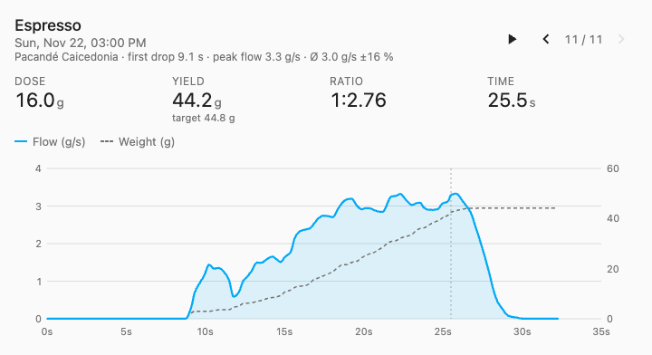

<p align="center">
  <picture>
    <source media="(prefers-color-scheme: dark)" srcset="custom_components/difluid_scale/brand/dark_logo@2x.png">
    
  </picture>
</p>

# DiFluid Microbalance for Home Assistant

A Home Assistant custom integration for the **DiFluid Microbalance** coffee scale over Bluetooth Low Energy.
It shows weight, flow rate, brew timer and battery live, and lets you tare and control the timer remotely.
It also records every brew automatically: dose, yield, ratio, brew time and the full flow profile, with sensors for the latest brew
and running totals (brew count, coffee ground). Each brew gets shot metrics (time to first drop, peak flow, mean flow and its variation)
and fires an event for your own automations.
A bundled dashboard card draws the flow curve live while you brew, shows each brew's target, bean and metrics, lets you browse and replay the last 20 brews, and can expand to full screen (animated) while a brew is prepared or running.
A "Prepare brew" switch puts the card into a ready view before the brew, with empty axes and the weighed dose.
An adaptive auto-stop switches the espresso machine (any switch, e.g. its smart plug) off early enough that the cup ends on a target brew ratio (ratio × the weighed dose) or a target yield, and learns its timing from every shot, ignoring single broken weight samples; every attempt is reported on an event entity, and a repair issue warns when the stop switch is missing or unavailable.
Bean profiles keep a target ratio per coffee: pick the bean and the target follows, and every brew remembers its bean.
Diagnostics (options, learned model, device, recent brews) can be downloaded from the integration page, and stores from older versions are migrated on the first start.

Tested with model `DFT-S101`, firmware `V320` and `V326`.

> Not affiliated with or endorsed by DiFluid.

## Features

| Entity | Description |
|---|---|
| Weight | Grams. Readings in ounces are converted to grams. |
| Flow rate | g/s |
| Timer | Brew timer (counts in seconds as observed; unit not documented) |
| Battery | Percent. Attributes: `charging`, `device_state` |
| Device state | Scale state (idle, timing, paused, ...) |
| Connected | Binary sensor for the BLE connection; always available |
| Key press | Event entity for buttons pressed **on the scale**: `power_click`, `timer_click`, `power_double`, `timer_double`, `power_long`, `timer_long`, `timer_press` |
| Tare | Button |
| Start / Stop / Reset timer | Buttons |
| Auto timer start / Auto timer stop | Switches for the scale's "auto detect / auto stop timing" settings |
| Weight unit | Select: gram / ounce / gering (third unit as named in the DiFluid protocol; no gram conversion documented, weight shows no value in this mode) |

Brew entities (last dose, yield, ratio, brew duration, brew count, coffee ground total, dose correction, prepare brew): see [Brew detection and brew card](#brew-detection-and-brew-card-030) below.

Auto-stop entities (target ratio, target yield, learned latency and drip, learning samples, deviation, auto-stop event, reset) and the services `delete_brew` and `learn_stop_from_brew`: see [Auto-stop at target ratio or yield](#auto-stop-at-target-ratio-or-yield-040) below.

Bean select: see [Bean profiles](#bean-profiles-050) below.

## Brew detection and brew card (0.3.0)

The integration records each brew automatically. Brew detection follows the **scale's own timer**:

- A brew starts when the timer starts and ends when it stops, plus a short capture tail (`tail_seconds`, default 3 s). With the auto-stop the tail is extra weighing after the weight is calm, before the timer is stopped (see [Auto-stop](#auto-stop-at-target-ratio-or-yield-040)). Without it (timer stopped by hand or by the scale) recording goes on for that long after the stop, but the paused scale sends no weight, so drops after the stop are not counted: stop the timer once the drips are in.
- Runs shorter than 5 s or with less than 5 g yield are discarded. Resetting the timer without a run is not a brew.
- **Dose** = the last stable weight between 12 and 25 g (stable within ±0.3 g for at least 3 s), seen within 30 minutes before the brew. Each weighed dose is used for one saved brew only; a discarded run (e.g. a purge) does not use it up. Without such a plateau, dose and ratio stay unknown.
- **Yield** = the last weight recorded (with the auto-stop: at the end of the extra weighing after the weight is calm). If the cup is lifted after the timer stop (weight drops by more than 5 g or below zero), the yield is the last weight before the drop, even if the lift comes before the stop was noticed. **Ratio** = yield / dose.
- **Bluetooth drops** during a brew do not split it: the brew waits for the scale to reconnect and continues if the scale's timer is still running from the same start. If the timer was reset meanwhile, or the scale is not back within 30 s, the brew is saved with the data up to the drop; if the same timer turns up later (still running, or stopped at a higher count), that brew is updated. If the timer stopped while the link was down, the first weight after the reconnect counts as the yield (unless the cup was already lifted). A link that goes silent before the drop is reported is treated the same way, not as a timer stop. When Home Assistant connects while the timer is already running, the brew starts at the timer's start. A reload of the integration or a Home Assistant restart mid-brew (or during a pause) hands the brew to the new instance.
- **Pause and resume** (e.g. pour-over): if the timer is stopped and later counts on from where it stopped (not reset to 0) within 5 minutes, it is the same brew. The saved brew is updated in place (same id, brew count and coffee total unchanged) and `difluid_scale_brew_completed` fires again with `updated: true`. Resetting the timer ends that possibility, and so does lifting the cup or weighing a new dose during the pause: a timer that then counts on from its stop value is a new brew.
- All thresholds can be changed under **Settings → Devices & services → DiFluid Microbalance → Configure**.

| Entity | Description |
|---|---|
| Last dose / Last yield | Grams, from the latest brew |
| Brew ratio | Yield / dose of the latest brew |
| Brew duration | Seconds from timer start to timer stop (a paused and resumed brew includes the pause); with the auto-stop to the cut (pump off), not to the timer stop after the drips |
| Brew count | Total number of brews (total increasing) |
| Coffee ground total | Sum of all known doses in grams (total increasing) |
| Dose correction | Number: sets the dose of the latest brew manually; the ratio is recomputed. Correcting a dose down and up again does not add to the coffee total twice. |
| Prepare brew | Switch: a brew is about to start; the brew card shows an empty live chart (see [Ready mode](#ready-mode-031)). Available while the scale is off. Turns itself off when the brew ends (saved or discarded) or after 10 minutes without a brew starting. Starts off after a restart. |

These entities keep their values while the scale is off. The last 20 brews, including their flow profiles, are stored in Home Assistant.
Each brew fires the event `difluid_scale_brew_completed` with `dose`, `yield`, `ratio`, `duration`, `brew_id`, `start`, `bean` (name of the active bean profile, or null), `target` and `target_source` (the auto-stop target of the brew, below), `metrics` (below) and `updated` (true when a resumed brew replaced its earlier version).

### Brew metrics (0.5.0)

Every saved brew gets `metrics`, computed from its stored profile:

| Key | Meaning |
|---|---|
| `first_drop` | Seconds from the timer start to the first drop: the weight is at least 1.5 g above the baseline and stays there for 1 s (the profile must show that second). Baseline: the median weight of the first second, at most 0; if it is above 1.5 g (cup not tared) there is no `first_drop`. Pump vibration moves an empty cup by 0.1–1.0 g, which does not count. |
| `peak_flow` | Highest flow in g/s |
| `mean_flow` | Mean flow in g/s in the main phase: weight gained ÷ time between 20 % and 90 % of the final weight (the ramp of the first drops and the end of the shot left out) |
| `flow_cv` | Variation of the flow in the main phase: standard deviation ÷ mean (0.15 = ±15 %) |

The flow is the one the brew card draws by default (`flow_smoothing: 3`): the weight made monotone (a drop is ignored), then the slope over the preceding 3 s. A value that cannot be computed (no drop, too little in the cup) is null. Brews saved before 0.5.0 get their metrics computed when the integration loads, if they have a profile.

### Brew card

The integration ships a Lovelace card and registers it as a dashboard resource automatically (storage mode). It plots the **flow rate** of a brew over time, with the weight as a second curve, and lets you browse the stored brews.

<picture>
  <source media="(prefers-color-scheme: dark)" srcset="docs/brew-card-dark.png">
  
</picture>

<sub>A real brew recorded by the integration with the auto-stop (default <code>flow_smoothing: 3</code>): 16.0 g dose, 44.2 g yield, 25.5 s.</sub>

```yaml
type: custom:difluid-brew-card
device_id: <your scale's device id>   # optional with a single scale
title: Espresso                       # optional
chart_height: fill                    # optional: pixels (100–2000) or fill
expand_when_active: true              # optional: full screen while ready or brewing
flow_smoothing: 3                     # optional: seconds (0–10), 0 = raw scale flow
```

**Chart height:** without `chart_height` the chart is 200 px high. A number sets the height in pixels. `fill` makes the card fill the rest of the screen: the chart grows until the card ends at the bottom of the visible window (never below 200 px), follows window resizes and rotation, and the live figures (time, flow, weight) get larger. Meant for a dashboard section that is shown only during a brew, e.g. on a tablet next to the machine. With a custom height the card lets its row in a sections view grow with it (`rows: auto`). Other values are rejected with an error in the card editor.

**Full screen while active (0.5.0):** with `expand_when_active: true` the card lifts itself out of its place while it is active, that is while the ready view shows ("Prepare brew" on, no brew yet) or a brew runs, including its tail; replaying a stored brew does not count. It then covers the dashboard view below the app header (the whole screen in kiosk mode), keeps the view's padding, lies on an opaque backdrop in the theme's background, and the chart fills the height whatever `chart_height` says. Its place in the grid keeps its size, so nothing below moves. When the brew ends (or "Prepare brew" is turned off), the card shrinks back into its place and shows the saved brew; `chart_height` applies again. Opening and closing are animated; it opens instantly with the system's "reduce motion" setting and whenever the card appears while already active (page opened, or the dashboard view switched back, during a brew or with "Prepare brew" on). Turning on "Prepare brew" during a replay ends the replay. While the card is expanded, swiping or scrolling on it does not scroll the dashboard underneath. The card never expands in dashboard edit mode or in the card editor. This replaces two card instances with section visibility conditions. Default: off.

**Live mode:** as soon as a brew starts, the card switches to it (also when you are looking at an older brew), shows elapsed time, flow rate and weight in large figures and draws the flow curve and the dashed weight curve as they come in. The axes start at an espresso range (30 s, 3 g/s, 40 g) and only grow. If the scale disconnects mid-brew, the card says so and continues when the scale is back. If the connection to Home Assistant fails, the card retries on its own. When the brew ends, the card shows the saved brew with dose, yield and ratio; a run that is not saved (too short, too little yield) is noted briefly and the card returns to the latest brew.

**Flow smoothing (0.3.1):** the scale's own flow value lags the weight by 1–1.5 s (it is a trailing regression over about 3 s), and the weight jumps back by up to a few grams after upward jumps during a brew. With `flow_smoothing` (seconds, default `3`) the card computes the flow curve from the weight instead: the weight may only rise (a drop is ignored, the last maximum is held), and the flow at each point is the slope of that weight over the preceding `flow_smoothing` seconds. Before the weight first rises by more than 1 g the flow is 0. Only earlier readings are used, so in live mode a point once drawn never changes. The dashed weight curve, the hover readout and the live flow and weight figures use these values; the axes grow with them. `0` shows the scale's raw flow and weight as before. The stored profiles and the `Flow rate` sensor are not changed. Values outside 0–10 are rejected with an error in the card editor.

**Detail line (0.5.0):** under the date of a stored brew the card shows its bean and metrics, e.g. `Kenya · first drop 8.8 s · peak flow 3.3 g/s · Ø 2.8 g/s ±19 %`; parts that are not known are left out. The line keeps its space during a live brew, so the card does not jump when the brew ends.

**Target (0.5.0):** with the auto-stop on, the card shows the brew's target in small text, e.g. `target 40.0 g`: under the yield of a stored brew, under the weight during a live brew and in the ready view (the target the next brew would get, ratio × the weighed dose or the fixed target yield; it follows changes of the target at once). Nothing is shown while the auto-stop is off and for brews saved before 0.5.0. Each brew stores `target` (g) and `target_source` (`ratio` or `yield`, both null with the auto-stop off): the target the auto-stop cut at if it fired, otherwise the target shown live (ratio × the brew's dose, or the fixed target yield, at the end of the brew). It records what was aimed at: it stays when the dose is corrected later or the auto-stop is turned off afterwards.

**Ratio:** stored brews show the ratio with two decimals (`1:2.43`), as saved.

**Replay:** the play button next to the brew navigation plays a stored brew back in real time, exactly like a live brew (curves building up, growing axes, time, flow and weight). The stop button ends it early; a brew that starts in the meantime takes over the card.

#### Ready mode (0.3.1)

Turn on **Prepare brew** (`switch.microbalance_prepare_brew` for a scale named "Microbalance") just before a brew, by hand or from an automation. While it is on and no brew runs, the card shows the live view with empty axes (30 s, 3 g/s, 40 g), time, flow and weight at 0, the dose the next brew would get (the weighed dose as in brew detection, or "–") and "Ready – brew starts soon". When the brew starts, the curves grow into that view; when it ends, the switch turns off and the card shows the saved brew. Turned off without a brew, the card returns to the brew history. `chart_height: fill` applies as in live mode.

To show a fullscreen brew section only around a brew, make it visible while the timer runs **or** the switch is on (section → Visibility, or in YAML):

```yaml
visibility:
  - condition: or
    conditions:
      - condition: numeric_state
        entity: sensor.microbalance_timer
        above: 0
      - condition: state
        entity: switch.microbalance_prepare_brew
        state: "on"
```

If your dashboard resources are managed in YAML, add the resource yourself:

```yaml
lovelace:
  resources:
    - url: /difluid_scale/difluid-brew-card.js
      type: module
```

### Websocket API

For your own frontends (all commands accept an optional `entry_id` or `device_id`; with a single scale both can be omitted):

| Command | Result |
|---|---|
| `difluid_scale/brews` | Brew summaries (no profiles), newest first; each with `bean`, `target`, `target_source` and `metrics` |
| `difluid_scale/brew` | One brew including its profile, `bean` and `metrics` (`brew_id`, default newest) |
| `difluid_scale/subscribe_brews` | Event with the newest brew summary whenever a brew is saved or its dose corrected |
| `difluid_scale/subscribe_live` | Live data of the running brew (below) |

`subscribe_live` events (`type` field):

- `live_start`: `start`, `start_ts`, `dose` (the dose this brew will get, or null), `points` (everything recorded so far, so a client subscribing mid-brew can draw the whole curve), plus the current values.
- `live_points`: only the new `points` since the last event, sent at most every 0.25 s, plus the current values.
- `live_end`: `brew_id` and `brew` (summary) if saved, otherwise `reason` (`too_short`, `low_yield`, `no_samples`, `unloaded`) and `detail`.
- `live_idle`: sent once on subscribe when no brew is running.
- `live_ready`: `ready` (true/false), the state of the Prepare brew switch, `dose` (the dose the next brew would get, or null) and `target` / `target_source` (its auto-stop target, or null with the auto-stop off); sent again when one of them changes. Sent on subscribe right after `live_start` / `live_idle`, and whenever the switch changes; when a brew ends, `ready: false` comes just before `live_end`.

Points are `[seconds since start, weight g, flow g/s]`. Current values: `weight`, `flow`, `timer`, `elapsed` (seconds; stops at the timer stop), `phase` (`brewing`, `tail`, `parked` = waiting for a reconnect), `stop` (seconds at the timer stop, or null) and `target` / `target_source` (the brew's auto-stop target, or null with the auto-stop off).

### Tests

`python3 tests/test_brew.py` runs the brew detection tests and `python3 tests/test_stop_model.py` the auto-stop model tests without Home Assistant. The full suite needs the Home Assistant test helpers: `pytest-homeassistant-custom-component` up to Home Assistant 2026.10, `pytest-homeassistant` (same version as Home Assistant) from 2026.11 on; then `pytest` from the repository root. It is run against the minimum version from `hacs.json` and the current release. Its fixtures in `tests/fixtures` are copies of real stores (brews with profiles, the learned model, the restored targets). `node tests/card_retry_test.mjs` tests the card's reconnect handling, `node tests/card_flow_test.mjs` the flow smoothing and the ready view, `node tests/card_expand_test.mjs` the expansion while active (all three also run by `pytest` when node is installed).

## Auto-stop at target ratio or yield (0.4.0)

Set a **target ratio** (e.g. 2.5, yield ÷ dose) and/or a **target yield**, and choose a **stop switch** (Configure → *Stop switch*, e.g. the smart plug of the espresso machine; turning it off must end the shot at once). While a brew runs, the integration turns that switch off early enough that the weight in the cup **after the dripping has settled** lands on the target, and learns from every shot. Without a stop switch, or with the target at 0, the feature is off.

| Entity | Description |
|---|---|
| Target ratio | Number, 0–5 (0 = off). With a dose detected for the running brew the target is ratio × dose; without one the target yield applies. With a [bean](#bean-profiles-050) active, a new ratio is written to its profile. |
| Target yield | Number, 0–100 g (0 = off). The target when no ratio is set, and the fallback for brews without a detected dose. |
| Stop latency | Learned `tau` in seconds (diagnostic) |
| Stop drip | Learned `c` in grams (diagnostic) |
| Stop learning samples | Number of shots the model has learned from (diagnostic) |
| Stop deviation | Settled yield − target of the last auto-stopped shot. Attributes: `target`, `target_source` (`ratio` or `yield`), `dose`, `cut_weight`, `cut_flow`, `predicted_overshoot`, `lead`, `final_yield`, `overshoot`, `accepted`, `reason` (`outlier`, `not_settled`, `cup_lifted`, `brew_discarded`, `brew_truncated`) |
| Auto-stop | Event entity, one event per step of an auto-stop: `cut` (switch turned off) or `switch_failed` (the call failed or the switch is missing or unavailable; reported only, the shot is handled as usual), then how it ended: `learned`, `outlier`, `not_settled`, `cup_lifted`, `brew_discarded`, `brew_truncated`. Attributes: `target`, `target_source`, `dose`, `cut_weight`, `cut_flow`, `predicted_overshoot`, `final_yield` and `deviation` (once known), `bean` |
| Reset stop learning | Button: back to the starting values |

Both targets are kept by the integration (with the learned model), so the auto-stop keeps its target when a target entity is disabled; 0.5.0 takes over the values the entities had before. A **repair issue** reports a stop switch that cannot be used: one that does not exist (checked when Home Assistant has started; a switch that is only briefly unavailable or a placeholder then does not count), one that is or becomes unavailable while Home Assistant runs (also checked when the options change or the integration is reloaded), and one that is missing or unavailable at a cut. It disappears once the switch is back or the option is emptied.

**How it works.** After the switch goes off the weight still rises: the command needs time (scale → Bluetooth → Home Assistant → plug → pump), and the puck drips. The overshoot is modelled as `c + tau × flow at the cut`. The flow is derived from the weight, not the scale's own flow value, which lags by 1–1.5 s: it is the median of the slopes between all pairs of weight samples of the last 2 s (Theil–Sen), so a sample that falls back by up to ~3 g after a jump (pump vibration) barely moves it (up to 0.4.0: the slope over the last second between just two samples). A single weight sample that jumps further than a shot can pour (more than 5 g down, or more than 5 g + 8 g/s × the time since the last sample up) is held back and decided by the next one: back on the old level, it is dropped and never drives a cut; on the new level (cup lifted or placed) both count. A flow above 8 g/s (espresso runs at 1–3 g/s, the fastest recorded shot peaked at 4.7 g/s) is treated as broken: the cut then only looks at `weight + c`. On every weight sample of a running brew (the scale's timer is counting) the integration checks

`weight + c + tau × flow + flow × dt/2 ≥ target`

and then turns the switch off (once per brew; the sample handler does not wait for it) but keeps the scale's timer running: while its timer is paused the scale sends no weight, so the drips would be missed. The timer is stopped once the weight is calm (changes by at most 0.2 g within 2 s) and then `tail_seconds` more have passed (default 3 s, for late drops), at the latest 20 s after the cut (a backstop), or at once if the cup is lifted. The weight at that moment is the saved yield, so it includes the drips. In the live view and in the saved brew the brew time ends at the cut (pump off) while the weighing goes on; the scale's own display keeps counting until its timer is stopped. The brew is saved right at that timer stop (no extra capture tail: the drips are already in). `dt/2` anticipates the sampling: the scale sends a weight only every ~0.3 s, so cutting at the first sample past the threshold would land up to one sample interval of flow late (0–1 g). `dt` is the median of the recent sample intervals in the running brew (0.3 s until known, limited to 0.1–1 s); this term is fixed, not learned. In a simulation with ~0.3 s samples and dropped frames it cut the mean absolute error from 0.48 g to 0.29 g (bias +0.48 → +0.15 g).

If the brew was saved normally, the shot is one learning sample: `x` = flow at the cut, `y` = final weight (at the timer stop above; before the lift if the cup was lifted after the weight was calm) − weight at the cut. A shot whose weight never calmed down within the 20 s is not learned (its saved yield still includes everything up to the timer stop). Since 0.5.0 the overshoot also includes late drops, so the first shots after updating from 0.4.x may land about one drop above the target until the model has caught up. `tau` and `c` are fitted by recursive least squares with a forgetting factor of 0.93 (roughly the last 14 shots count), starting from `tau` = 1.0 s and `c` = 0.3 g. The first three samples only adjust `tau` (`c` stays at 0.3 g, since the first shots rarely differ enough in flow to separate the two); both are fitted from the fourth on. `tau` stays within 0–3 s, `c` within −0.5–3 g. Shots with an overshoot outside 0–5 g (cup bumped or lifted), with a flow at the cut above 8 g/s, or with a dropped sample (or a confirmed weight jump) within the 2 s before the cut (reported as `outlier`), discarded or truncated brews, and shots stopped any other way are not learned. A weight more than 5 g above the target, or one that is already past the threshold when the brew starts, never triggers a cut (a cup that was not tared).

Notes: the learned model is stored per scale and removed with the integration. It is one model for all beans; the bean is stored with each brew for your own analysis only. Because the timer keeps running until the weight is calm plus `tail_seconds`, the saved brew's yield includes the drips; the brew time ends at the cut. "Prepare brew" is not needed for the auto-stop.

### Services

`delete_brew` and `learn_stop_from_brew` accept an optional `entry_id` or `device_id`, the bean services an optional `config_entry_id`; with a single scale these can be omitted.

| Service | Fields | Effect |
|---|---|---|
| `difluid_scale.delete_brew` | `brew_id` | Removes a saved brew. Brew count goes down by 1 and coffee ground total by the dose that brew had added; sensors and the card update. No brew-completed event. |
| `difluid_scale.learn_stop_from_brew` | `brew_id`, `cut_offset` (s since the brew start), `target` (optional) | Teaches the auto-stop from a past brew, e.g. one stopped by an earlier automation. The profile point at or just before `cut_offset` is the cut: its weight, and the flow computed the same way as live (same sample filter). Learning sample: saved yield − that weight, with the same acceptance checks as a live shot. Returns the sample (`weight_at_cut`, `flow_at_cut`, `clean_cut` (false: a sample was dropped within 2 s before the cut, not learned), `overshoot`, `accepted`, the model after the update, and `deviation` if `target` is given). |
| `difluid_scale.add_bean` | `name`, `ratio` (optional, 0.5–5; default: the current target ratio), `note` (optional), `activate` (optional, default true) | Adds a [bean profile](#bean-profiles-050) exactly like the options do, without reloading the integration or touching a running brew. Same name rules as the options (unique, case-insensitive, at most 60 characters, not `none`/`Keine`/`unknown`/`unavailable`). With `activate` it becomes the active bean and the target ratio follows; the first bean always becomes active. Returns `bean_id`, `name`, `ratio`, `active`. |
| `difluid_scale.delete_bean` | exactly one of `name`, `bean_id`, `active: true` | Deletes a bean profile by name (case-insensitive), by id, or the active bean. Like a delete in the options: saved brews keep the name; if it was the active one, the newest remaining bean becomes active and its ratio the target; after the last bean none is active and the target ratio stays. Returns `bean_id`, `name`. |

Note that `brew_count` and `coffee_total` are *total increasing* sensors: Home Assistant's long-term statistics read a decrease as a meter reset.

## Bean profiles (0.5.0)

Under **Configure → Add / Edit / Delete bean profile** each coffee gets a name, a target ratio and an optional note. The entity below picks the active one:

| Entity | Description |
|---|---|
| Bean | Select: one of the bean profiles; `none` only while there are none. Choosing a bean sets the target ratio to its ratio; changing the target ratio while a bean is active updates the profile. Kept across restarts. Every saved brew stores the bean's name (`bean`, or null). |

As soon as there is a bean profile, one is always active: the first one you add becomes active, and if the active one is deleted the newest remaining one takes over (its ratio becomes the target, also in the middle of a brew, just like choosing it; the brew keeps the bean it started with). "Newest" means the profile created last: profiles keep the order in which they were created, editing does not move them. After deleting the last profile no bean is active and the target ratio stays. If no active bean is stored (e.g. after an update) the newest one becomes active at startup; otherwise a restart keeps the stored target ratio, also one set by hand. Renaming or deleting a profile does not change brews saved before.

Beans can also be added and deleted from a dashboard with the services [`add_bean` and `delete_bean`](#services), e.g. a text helper for the name and two buttons. When a button is pressed on a dashboard, a service error (empty or taken name) shows up as a notification in the frontend.

```yaml
# Helper: input_text.new_bean, max length 60 (Settings → Devices & services → Helpers)
script:
  add_bean:
    alias: Add bean
    sequence:
      - action: difluid_scale.add_bean   # ratio: the current target ratio; empty/taken names are rejected with a message
        data:
          name: "{{ states('input_text.new_bean') }}"
      - action: input_text.set_value
        target: {entity_id: input_text.new_bean}
        data: {value: ""}

# Dashboard
type: vertical-stack
cards:
  - type: entities
    entities:
      - select.microbalance_bean        # your scale's "Bean" entity
      - input_text.new_bean
  - type: horizontal-stack
    cards:
      - type: button
        name: Add bean
        icon: mdi:seed-plus-outline
        tap_action: {action: perform-action, perform_action: script.add_bean}
      - type: button
        name: Delete bean
        icon: mdi:seed-off-outline
        tap_action:
          action: perform-action
          perform_action: difluid_scale.delete_bean
          data: {active: true}           # the bean selected above
```

## Diagnostics

**Settings → Devices & services → DiFluid Microbalance → ⋮ → Download diagnostics** gives the options, the learned stop model (`tau`, `c`, covariance, sample count), the last auto-stop result, targets and bean profiles, device info and firmware, the connection state and the last five brews without their profiles. The Bluetooth address and the serial number are redacted.

A raw weight jump of 50 g or more between two readings is logged as a warning with the frame data and the last raw notifications, to track down broken frames.

## Upgrading to 0.5.0

- The **Timer** sensor no longer has a state class (it restarts with every brew). Home Assistant then lists its old long-term statistics under **Developer tools → Statistics**; delete them there.
- On the first start the targets are taken over from the target entities, the stored brews get their metrics, and the stores are converted (1.2). A downgrade to 0.4.x still reads them. Targets changed while on 0.4.x are overwritten by the stored 0.5 settings when upgrading again.

## Installation

### HACS (recommended)

1. In HACS, search for **DiFluid Microbalance**.
2. Download it and restart Home Assistant.

### HACS custom repository (fallback)

If the integration does not show up in the search yet:

1. In HACS, open the menu → **Custom repositories**.
2. Add `https://github.com/radecke/ha-difluid-microbalance` with type **Integration**.
3. Download **DiFluid Microbalance** and restart Home Assistant.

### Manual

Copy `custom_components/difluid_scale` into your `config/custom_components/` folder and restart Home Assistant.

## Setup

Requires a working [Bluetooth](https://www.home-assistant.io/integrations/bluetooth/) setup with an adapter or proxy that supports **active connections**.

After connecting, the integration waits 1 s before it subscribes to the scale's notifications and leaves 0.3 s between its setup commands; without that pause the first attempt through an ESPHome Bluetooth proxy sometimes failed with `Insufficient authorization`.

Turn the scale on. Home Assistant discovers it automatically; confirm the discovery. You can also add it manually via **Settings → Devices & services → Add integration → DiFluid Microbalance**.

## Limitations

- The scale accepts **one** BLE connection. While Home Assistant is connected, the DiFluid app cannot connect. Disable the integration temporarily to use the app.
- Powering the scale off via Bluetooth does not work. The documented command is acknowledged, but the scale stays on.
- The scale does not accept settings while the timer is running.
- The scale sends no weight while its timer is paused; weight updates resume when the timer runs again or is reset.
- A reload of the integration (or a restart) in the middle of a brew gives that brew the bean that is active when it ends, not the one at its start.
- A reload, restart or Bluetooth drop between an auto-stop cut and the timer stop: the timer keeps running until it is stopped by hand, and the saved brew time is the full timer time (the cut time is only kept in memory).
- With bean profiles there is no "no bean" choice; delete all profiles to brew without one.
- Only the cleartext channel is used. The encrypted channel requires DiFluid's server-side activation and is not supported.

## Protocol

Based on DiFluid's public protocol description in [DiFluid/difluid-sdk-demo](https://github.com/DiFluid/difluid-sdk-demo/blob/master/docs/protocolMicrobalance.md) (MIT).
Some behaviour (e.g. timer state `15`, "timer ready") was observed on the device and is not in the documentation.

## License

MIT
