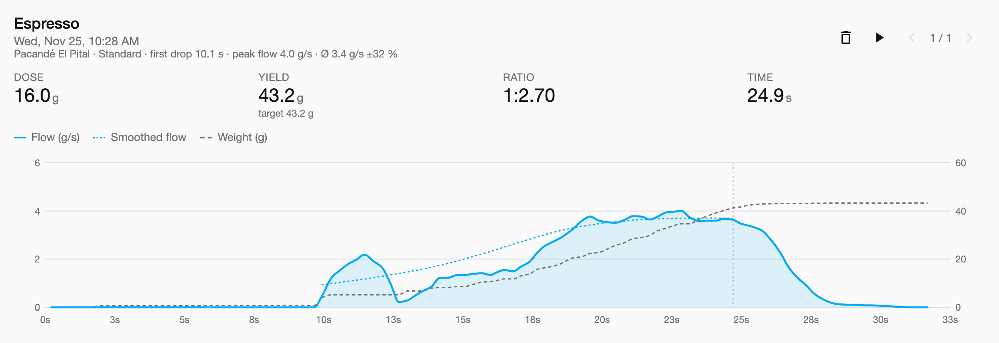

# Brew card

Reference for [DiFluid Microbalance for Home Assistant](../README.md). The card plots the **flow rate** of a brew over time, with the weight as a second curve, and lets you browse the stored brews.

<picture>
  <source media="(prefers-color-scheme: dark)" srcset="brew-card-dark.png">
  
</picture>

- [Resource](#resource)
- [Options](#options)
- [Live mode](#live-mode)
- [Ready mode](#ready-mode)
- [Full screen while active](#full-screen-while-active)
- [Stored brews](#stored-brews)
- [Pump power band](#pump-power-band)
- [Profile preview (tile feature)](#profile-preview-tile-feature)

## Resource

The integration registers the card as a dashboard resource automatically (dashboards in storage mode), with its version as `?v=` so that browsers load the new card after an update.

Dashboards in YAML mode need the resource by hand. Add the integration's version as `?v=` and change it with every update:

```yaml
lovelace:
  resources:
    - url: /difluid_scale/difluid-brew-card.js?v=0.7.0
      type: module
```

## Options

```yaml
type: custom:difluid-brew-card
device_id: <your scale's device id>   # optional with a single scale
title: Espresso                       # optional
chart_height: fill                    # optional: pixels (100–2000) or fill
expand_when_active: true              # optional: full screen while ready or brewing
flow_smoothing: 3                     # optional: seconds (0–10), 0 = raw scale flow
```

**`chart_height`.** Without it the chart is 200 px high. A number sets the height in pixels (100–2000). `fill` makes the card fill the rest of the screen: the chart grows until the card ends at the bottom of the visible window (never below 200 px), follows window resizes and rotation, and the live figures (time, flow, weight) get larger. Meant for a dashboard section that is shown only during a brew, e.g. on a tablet next to the machine. With a custom height the card lets its row in a sections view grow with it (`rows: auto`). Other values are rejected with an error in the card editor.

**`flow_smoothing`** (seconds, default `3`). The scale's own flow value lags the weight by 1–1.5 s (it is a trailing regression over about 3 s), and the weight jumps back by up to a few grams after upward jumps during a brew. With `flow_smoothing` the card computes the flow curve from the weight instead: the weight may only rise (a drop is ignored, the last maximum is held), and the flow at each point is the slope of that weight over the preceding `flow_smoothing` seconds. Before the weight first rises by more than 1 g the flow is 0. Only earlier readings are used, so in live mode a point once drawn never changes (except after [held-back data](brews.md#brew-detection)). The dashed weight curve, the hover readout and the live flow and weight figures use these values; the axes grow with them. `0` shows the scale's raw flow and weight. The stored profiles and the `Flow rate` sensor are not changed. Values outside 0–10 are rejected with an error in the card editor.

**`expand_when_active`** (default off): see [Full screen while active](#full-screen-while-active).

## Live mode

As soon as a brew starts, the card switches to it (also when you are looking at an older brew), shows elapsed time, flow rate and weight in large figures and draws the flow curve and the dashed weight curve as they come in. The axes start at an espresso range (30 s, 3 g/s, 40 g) and only grow. If the scale disconnects mid-brew, the card says so and continues when the scale is back. If the connection to Home Assistant fails, the card retries on its own. When the brew ends, the card shows the saved brew with dose, yield and ratio; a run that is not saved (too short, too little yield) is noted briefly and the card returns to the latest brew.

With the auto-stop on, the card shows the brew's **target** in small text under the weight, e.g. `target 40.0 g`.

## Ready mode

Turn on **Prepare brew** (`switch.microbalance_prepare_brew` for a scale named "Microbalance") just before a brew, by hand or from an automation. While it is on and no brew runs, the card shows the live view with empty axes (30 s, 3 g/s, 40 g), time, flow and weight at 0, the dose the next brew would get (the weighed dose as in brew detection, or "–") and "Ready – brew starts soon". With the auto-stop on it also shows the target the next brew would get (ratio × the weighed dose, or the fixed target yield) and follows changes of the target at once. When the brew starts, the curves grow into that view; when it ends, the switch turns off and the card shows the saved brew. Turned off without a brew, the card returns to the brew history. `chart_height: fill` applies as in live mode. Turning on "Prepare brew" during a replay ends the replay.

The same switch gates the [pump profiles](pump-control.md#prepare-brew-gate).

To show a full-screen brew section only around a brew without `expand_when_active`, make it visible while the timer runs **or** the switch is on (section → Visibility, or in YAML):

```yaml
visibility:
  - condition: or
    conditions:
      - condition: numeric_state
        entity: sensor.microbalance_timer
        above: 0
      - condition: state
        entity: switch.microbalance_prepare_brew
        state: "on"
```

## Full screen while active

With `expand_when_active: true` the card lifts itself out of its place while it is active, that is while the ready view shows ("Prepare brew" on, no brew yet) or a brew runs, including its tail; replaying a stored brew does not count.

- It then covers the dashboard view below the app header (the whole screen in kiosk mode), keeps the view's padding, lies on an opaque backdrop in the theme's background, and the chart fills the height whatever `chart_height` says.
- Its place in the grid keeps its size, so nothing below moves.
- When the brew ends (or "Prepare brew" is turned off), the card shrinks back into its place and shows the saved brew; `chart_height` applies again.
- Opening and closing are animated; it opens instantly with the system's "reduce motion" setting and whenever the card appears while already active (page opened, or the dashboard view switched back, during a brew or with "Prepare brew" on).
- While the card is expanded, swiping or scrolling on it does not scroll the dashboard underneath.
- The card never expands in dashboard edit mode or in the card editor.

This replaces two card instances with section visibility conditions.

## Stored brews

**Swipe between brews (0.7.0).** On touch devices you can swipe between the stored brews: to the right for the older one, to the left for the newer one.

**Smoothed flow.** A stored brew also gets a second, calm flow line (dotted, "Smoothed flow" in the legend; the hover readout adds its value as `(Ø 2.1)`). Since the whole brew is known, it is centred rather than trailing: single outlier frames are replaced, the weight is fitted non-decreasing, and the flow is the slope of a Gaussian-weighted local fit (σ 2.5 s). It spans the brew from the first drop to the brew end (auto-stop cut, else timer stop), so the drips after the cut do not pull it down. Not shown live, in the ready view or during a replay.

**Detail line.** Under the date of a stored brew the card shows its bean, its pump profile and [metrics](brews.md#brew-metrics), e.g. `Kenya · Allongé · first drop 8.8 s · peak flow 3.3 g/s · Ø 2.8 g/s ±19 %`; parts that are not known are left out. The pump profile (0.7.0) is the one the brew started with, shown when a stop switch or a pump power entity is set up (with the scale alone there is none); older brews may not have one. During a live brew the line shows the running brew's profile.

**Target.** Under the yield of a stored brew the card shows the brew's stored target (`target`, see [Stored brew](brews.md#stored-brew)). Nothing is shown for brews stored without one (auto-stop off, or saved before 0.5.0).

**Ratio.** Stored brews show the ratio with two decimals (`1:2.43`), as saved.

**Replay.** The play button next to the brew navigation plays a stored brew back in real time, exactly like a live brew (curves building up, growing axes, time, flow and weight). The stop button ends it early; a brew that starts in the meantime takes over the card.

**Delete.** The bin icon next to the navigation of a stored brew deletes that brew after a confirmation in the card ("Delete the brew of Nov 23, 07:47 PM?", in German "Bezug vom 23.11. 19:47 löschen?"; for a brew the auto-stop learned from, followed by "It is also removed from the auto-stop learning."). The card then shows the next older brew (or the newer one if it was the oldest). The icon is not shown in the live view, the ready view or during a replay. It calls the [`delete_brew`](services.md#difluid_scaledelete_brew) service; the totals are not reduced.

## Pump power band

For brews with a pump relay start, the card uses the shot time (from the relay start) for the time and the first drop. With the pump throttle or a pump profile it draws the pump power as a step line in a band under the chart (dashed when only observed, i.e. the integration did not control the pump: mode `observe` or no usable pump entity; the legend key too), names the profile in the legend and marks the target shot time of the Zielzeit throttle. Pointing at the chart also shows the pump power at that time ("Pump 62 %") with a marker on the line, only when the pump was controlled (an observed power was never set). The band, its legend key and the hover value need a *Pump power* entity (0.7.0): without one the power is neither set nor read, and nothing is drawn.

The line is yellow by default; the theme variable `difluid-pump-color` changes it (fallback `yellow-color`). A shot the throttle found too fast (it triggered, also in `observe`; `grind_finer` in the record) shows **grind finer** under the time, a skipped profile "*profile* skipped (not prepared): full power" under the time. Details: [Pump control](pump-control.md).

**Brews stored by the 0.7.0 test versions:** records without the new fields `pump` and `controlled` are read as before for the line style (dashed: mode `observe` or the power never written), but their band is drawn only when the power was really written (`applied`). Older observed brews therefore show no band any more, also those that had a pump entity: their records cannot tell whether one was set up.

## Profile preview (tile feature)

A tile feature for the **Pump profile** select (0.7.0): under the select's own dropdown it shows the selected profile's pump power course; for *Zielzeit* (the adaptive throttle, it has no fixed course) the **Target shot time** and for *Standard* the **Standard pump power** (0.7.0) of the same scale as − value + buttons instead. Under every view a **Brew Ratio** row sets the target ratio ("1 : 2.8", − and +). It follows the profile when you change it. Part of the card's resource, no extra setup.

```yaml
type: tile
entity: select.<your scale>_pump_profile
features:
  - type: select-options
  - type: custom:difluid-profile-preview
grid_options:
  rows: auto   # sections view: let the card grow with the preview
```

In a sections view the grid sizes a tile card from the number of its features, one feature row each; the preview is taller than one row and would overflow into the next card, so the card needs `rows: auto`.

From top to bottom (0.7.0):

- **Chips:** at every phase end what ends that phase, centred on the border: its exits in their order, then its duration, separated by " / " — "1.5 g / 12 s" (the cup weight the scale shows, after the tare), "≥ 1.5 g/s" or "≤ 0.8 g/s" (the scale flow, counted after the first drops), "1 : 2" (× the brew's dose); "≤" before a weight or ratio exit that ends the phase when the value falls to it. Only a duration: "30 s"; flow values with the decimals they have ("2.25 g/s"). At the right end "Target weight": the last phase runs until the auto-stop ends the shot — only when the auto-stop has a target (a stop switch and a target ratio or yield); without one there is no end chip. Chips that would overlap are moved apart, at most half their width from their border; what still does not fit is left out whole, never shortened (first the end chip, then the latest chip in the way): no chip rather than one that tells only part of what ends a phase. A ratio exit is shown even though the engine ignores it in a brew without a detected dose.
- **Graph:** what the integration would set: steps and ramps with their curves, powers clamped to the *Pump throttle floor* (0 % stays 0). Dashed: a phase that may end before its maximum (a weight, flow or ratio exit), drawn to its maximum. Hatched over the full height: a flow phase (the controller sets the power live), with its target flow in the middle (left out where the area is too narrow), and a transition that starts from it. The end fades out (its length there is not a time). Fine ticks at the phase borders, no axis labels.
- **Names:** each phase's `name`, centred under its section including its own transition (the engine runs a phase's transition from that phase's start); cut with an ellipsis, left out where too narrow. The return to full power after a short last phase is no phase and has no name.
- **Labelled inputs (0.7.0):** Zielzeit shows "Target time" and Standard "Pump power" next to a compact − value + (like the Brew Ratio row), right-aligned, the label outside the grey area.
- **Standard:** the *Standard pump power* instead of a graph, operable only when the pump power is really controlled (mode `throttle` and a pump power entity that is available); otherwise greyed out at a fixed 100 % with disabled buttons (that is what the pump then runs at). It follows mode, options and the pump's availability without a page reload.
- **Brew Ratio:** the target ratio of the same scale ("off" at 0, "–" while unavailable); no row without that entity. Without the Zielzeit or Standard number the row is shown alone.

Profile and phase names follow Home Assistant's language (built-ins; imported ones as they are). The preview shows the selected profile whatever the mode, the pump entity or *Prepare brew*, in the same colour as the card's pump line (`difluid-pump-color`).
